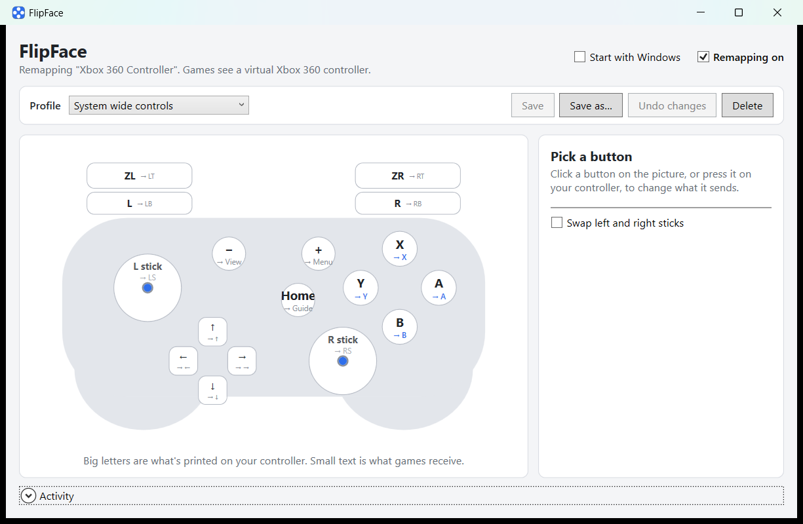

# FlipFace

Remap your controller's buttons on Windows, and have every game see the result.

FlipFace started with one annoyance: Switch-layout controllers, like the Onikuma C1, have **A and B (and X and Y) printed in swapped positions** compared to an Xbox pad. When a game says "press A", you have to press the button labelled B. FlipFace fixes that with one click, and lets you remap any button to any other.



## Features

- **Match labels** preset: printed A, B, X and Y act as Xbox A, B, X and Y.
- Remap any button or trigger to any other, or turn it off. Several buttons can send the same one.
- Triggers can act as buttons (with an adjustable press point), and buttons can act as fully pulled triggers.
- Swap the sticks, invert either axis, and set a deadzone per stick.
- A live picture of your controller shows what's printed on each button, what it sends, and what you're pressing.
- Profiles, saved as small JSON files. FlipFace remembers which profile each controller used last.
- Lives in the tray, can start with Windows, and can be switched off with a click.
- **Games see only one controller.** Your real pad is hidden from them, so there are no double inputs, and it's never left hidden: FlipFace unhides it when it exits, and repairs things on the next start if it ever crashes.

## Requirements

- Windows 10 or 11, 64-bit
- Two free drivers by Nefarius. FlipFace checks for them and links to them on first start:
  - [ViGEmBus](https://github.com/nefarius/ViGEmBus/releases/latest) creates the virtual Xbox 360 controller games see.
  - [HidHide](https://github.com/nefarius/HidHide/releases/latest) hides your real controller from games. Restart your PC after installing it.

You don't need to install .NET; it's built into `FlipFace.exe`.

## Getting started

1. Install ViGEmBus and HidHide, then restart your PC.
2. Plug in your controller and run `FlipFace.exe`.
3. FlipFace starts with the **Match labels** profile. Pick another profile, or click a button on the picture (or press it on your controller) to change what it sends, then **Save**.

Closing the window keeps FlipFace running in the tray. Right-click the tray icon to switch profiles, turn remapping off, start with Windows, check setup, or exit.

**Start FlipFace before your game**, or restart the game afterwards: a game that already had your controller open may keep seeing it.

## Profiles

Profiles live in `%AppData%\FlipFace\profiles`. Each one lists only what it changes:

```jsonc
{
  "name": "My layout",
  "buttons": {
    "East": "South",                  // the right face button sends Xbox A
    "RightShoulder": "RightTrigger",  // R pulls the right trigger fully
    "Guide": null                     // Home does nothing
  },
  "rightStick": { "deadzone": 0.1, "invertY": true },
  "swapSticks": false,
  "triggerThreshold": 0.5
}
```

Buttons are named by **position**, not label: `South`, `East`, `West`, `North`, `Back`, `Start`, `Guide`, `LeftStick`, `RightStick`, `LeftShoulder`, `RightShoulder`, `DPadUp`, `DPadDown`, `DPadLeft`, `DPadRight`, plus `LeftTrigger` and `RightTrigger`. Comments and trailing commas are allowed.

## Command line

`FlipFace.Cli` runs the same remapper without a window:

| Command | What it does |
|---|---|
| `FlipFace.Cli` | Remap with "Match labels" until Ctrl+C |
| `FlipFace.Cli --profile "My layout"` | Remap with another profile |
| `FlipFace.Cli --profiles` | List profiles and where they're saved |
| `FlipFace.Cli --new-profile "My layout"` | Save a copy of "Match labels" to edit |
| `FlipFace.Cli --restore` | Make a controller FlipFace left hidden visible again |

## How it works

1. **Read:** [SDL3](https://github.com/libsdl-org/SDL) reads your controller through raw input, by button position.
2. **Hide:** [HidHide](https://github.com/nefarius/HidHide) hides the real controller from every app except FlipFace. That covers raw input, DirectInput and XInput.
3. **Remap and replay:** your profile is applied, and the result goes to a virtual Xbox 360 controller created through [ViGEmBus](https://github.com/nefarius/ViGEmBus), about once per millisecond.

Before FlipFace hides a controller, it writes the controller to `%AppData%\FlipFace\hidden-devices.txt`. It unhides everything listed there on exit, on unplug, and at the next start after a crash.

## Known limitations

- Remaps one controller at a time.
- The controller picture uses Switch-style labels. Only the Onikuma C1 (wired, XInput mode) has been tested.
- The virtual controller usually lands in XInput slot 2, because the hidden real one keeps slot 1. Games that only read slot 1 won't see it; most read all four.
- Some anti-cheat systems block virtual controllers.
- Steam Input can apply its own remapping on top. Turn it off for the game if buttons end up swapped twice.

## Building from source

You need the [.NET 10 SDK](https://dotnet.microsoft.com/download/dotnet/10.0).

```powershell
dotnet build FlipFace.slnx       # build everything
dotnet test                      # run the unit tests
.\publish.ps1                    # make artifacts\FlipFace.exe (single self-contained file)
```

| Project | Role |
|---|---|
| `src/FlipFace.Core` | Profiles, the mapping engine, presets (no I/O except profile files) |
| `src/FlipFace.Input` | Reads controllers with SDL3 |
| `src/FlipFace.Output` | The ViGEm virtual Xbox 360 controller |
| `src/FlipFace.Setup` | HidHide, driver checks, the hidden-device ledger |
| `src/FlipFace.Runtime` | The remap loop and the setup check |
| `src/FlipFace.App` | The tray app (WPF) |
| `src/FlipFace.Cli` | The command-line host |
| `tools/FlipFace.Probe` | Shows what SDL sees; `--identify` finds where each printed button sits |
| `tests/FlipFace.Core.Tests` | Unit tests for mapping and profiles |

## Credits

FlipFace builds on [SDL3](https://github.com/libsdl-org/SDL) (via [ppy/SDL3-CS](https://github.com/ppy/SDL3-CS)), and on [ViGEmBus](https://github.com/nefarius/ViGEmBus), [ViGEm.NET](https://github.com/nefarius/ViGEm.NET) and [HidHide](https://github.com/nefarius/HidHide) by Nefarius Software Solutions.

## License

FlipFace is released under the [MIT License](LICENSE). The libraries and drivers above keep their own licenses.
